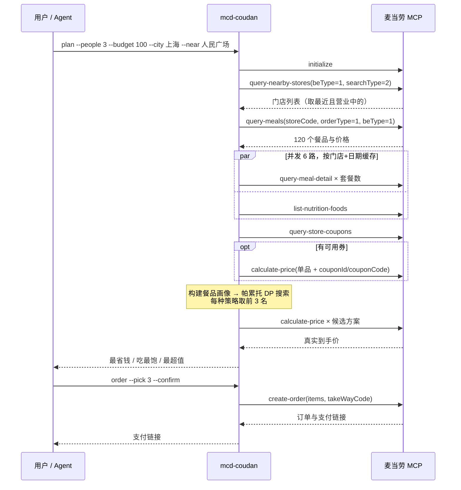
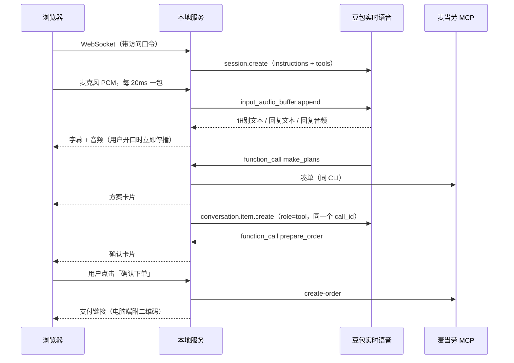

# MCP 集成说明

## 使用的 MCP Server

| 项目 | 值 |
|---|---|
| Server | 麦当劳中国 MCP Server（`mcd-mcp`） |
| 地址 | `https://mcp.mcd.cn` |
| 传输协议 | Streamable HTTP（JSON-RPC 2.0，支持 JSON 与 SSE 两种响应） |
| 鉴权 | 请求头 `Authorization: Bearer ${MCD_MCP_TOKEN}` |
| 配置示例 | [`mcp-config.example.json`](mcp-config.example.json)（只用环境变量占位符） |

CLI 模式下，项目通过 [`src/mcp-client.js`](src/mcp-client.js) 直连 MCP Server。这是一个零依赖的 Streamable HTTP 客户端，实现了 `initialize` 握手、`Mcp-Session-Id` 会话保持、SSE 响应解析，并对 401（Token 无效）、429（超过 600 次/分钟）给出明确提示。麦当劳 MCP 的文本结果一般是「给模型看的展示说明 + JSON」，客户端会按括号配对把 JSON 抽出来，供程序使用。

Skill 模式下，Agent 通过客户端里配置的 `mcd-mcp` 连接器直接调用同一批工具，流程见 [`skills/mcd-coudan/SKILL.md`](skills/mcd-coudan/SKILL.md)。

## 使用的 Tool

| Tool | 用途 | 读/写 | 代码位置 |
|---|---|---|---|
| `query-nearby-stores` | 按城市和地点搜到店门店，选最近的营业门店 | 读 | `planner.js` `findPickupStores` |
| `delivery-query-addresses` | 读取配送地址（麦乐送） | 读 | `planner.js` `findDeliveryStore` |
| `delivery-query-stores` | 查地址可配送的门店，拿到 `beCode` | 读 | `planner.js` `findDeliveryStore` |
| `query-meals` | 门店实时菜单：价格、原价、优惠类型 | 读 | `planner.js` `makePlans` |
| `query-meal-detail` | 套餐每一轮的默认选项，用来判断能覆盖几份主食/小食/饮料 | 读 | `planner.js` `loadDetails` |
| `list-nutrition-foods` | 餐品热量，用于「吃最饱」策略 | 读 | `catalog.js` `parseNutrition` |
| `query-store-coupons` | 当前门店账户可用券 | 读 | `planner.js` `couponCandidates` |
| `calculate-price` | ① 试算单张券的券后价 ② 校验每个候选方案的真实到手价（含配送费、打包费） | 读 | `planner.js` |
| `available-coupons` | 预览麦麦省可领的券 | 读 | `cli.js` `claim` |
| `auto-bind-coupons` | 麦麦省一键领券（需加 `--confirm`） | 写 | `cli.js` `claim --confirm` |
| `create-order` | 按选定方案下单，返回支付链接（需加 `--confirm`） | 写 | `cli.js` `order --confirm` |

两个写操作都必须由用户显式加上 `--confirm` 才会执行；不加时只会预览。

语音点餐（`src/voice/session.js`）复用同一批工具，再加上 `query-order` 查订单状态。语音模型拿不到写操作：它调用 `prepare_order` 时只会在屏幕上弹出确认卡片，必须由用户亲手点击「确认下单」，服务端才会调用 `create-order`。

## 调用流程

一次完整的 `plan` 第一次运行时大约发起 70 多次调用（大部分是套餐详情），用时约 8 秒；同一门店当天再次运行会命中缓存，只需要十几次，远低于每分钟 600 次的限流。

## 语音点餐：豆包实时语音 × 麦当劳 MCP

语音部分接的是豆包实时语音模型 3.0（Seeduplex，全双工），用户可以随时插话打断。豆包负责听和说；凑单和下单走 Function Calling，回到本地服务后再调用麦当劳 MCP：

| 暴露给语音模型的函数 | 背后的麦当劳 MCP 调用 | 说明 |
|---|---|---|
| `make_plans` | `query-nearby-stores` / `delivery-*` → `query-meals` → `query-meal-detail` → `query-store-coupons` → `calculate-price` | 与 CLI `plan` 相同。返回给模型的是精简摘要，方便口播；完整方案卡片推送到页面 |
| `prepare_order` | 无 | 只在页面上弹出确认卡片，告诉模型「还没有下单」 |
| （页面「确认下单」按钮） | `create-order` | 唯一的写操作入口，不经过语音模型 |
| `order_status` | `query-order` | 用户问「付好了吗」「到哪了」时查询 |

接入时处理的几个点：

- **密钥不进浏览器**：浏览器的 WebSocket 不能加自定义请求头，所以由本地服务带 `X-Api-Key` 连豆包，浏览器只连本地服务，并且要带访问口令。
- **音频节奏**：上行音频必须按实时节奏发送，每包 20ms、640 字节。浏览器用 AudioWorklet 把麦克风重采样到 16kHz，凑满一包就发。静音时发送 `input_audio_mute.commit`，避免服务端因为收不到音频而超时。
- **下行音频**：选用 `pcm_s16le` 24kHz，浏览器直接用 Web Audio 排队播放，不需要 Opus 解码。识别到用户开口（`input_audio_transcription.started`）时立刻停止播放，实现插话打断。
- **函数回传**：同一个 `response.function_call_arguments.done` 里可能有多个调用，全部执行完后，用一条 `conversation.item.create` 按各自的 `call_id` 一起回传。工具出错时也要回传 `{ok:false,error}`，否则模型会一直等。
- **优雅关闭**：浏览器断开时，先发 `session.close` 再关闭上游连接，避免服务端报 `ContextCanceled`。

## 实际接入中处理的细节

- **随单购价格**：`query-meals` 里 `discountType` 为「随单购麦金卡优惠」「随单购早餐卡优惠」的餐品，`currentPrice` 是买卡之后的价格。实测不带 `withOrder` 调用 `calculate-price` 时，会按 `originalPrice` 收费（例如巨无霸四件套：菜单显示 32 元，实际 58.5 元）。因此凑单时按原价计算。
- **套餐默认搭配**：`calculate-price` / `create-order` 不传 `roundList` 时，按 `query-meal-detail` 中 `isDefault=1` 的选项计价，所以画像也按默认选项来建。
- **省了多少**：套餐价本身已经包含优惠，`calculate-price` 的 `discount` 只反映额外促销。因此「比单点省」用菜单原价合计减去到手价来算。
- **外送费用行**：外送时，`productList` 里会出现「打包服务费」这样的费用行，展示时会过滤掉。到手价使用 `price` 字段，其中已经包含配送费和打包费。
- **场景参数**：严格按工具说明传参。到店自取 `orderType=1, beType=1`，不传 `beCode`；麦乐送 `orderType=2, beType=2`，必须传 `beCode`。

## 业务价值

- **对用户**：把「几个人、多少钱、怎么点」这个高频小决策压缩成一条命令，而且每个价格都经过麦当劳官方实时校验，不会出现「AI 说 60，结账 80」的情况。
- **对麦当劳**：把套餐、随心配、多人餐这些高性价比组合主动推到用户面前，自动用上用户已有的券，并引导领取麦麦省优惠券；从方案到 `create-order` 下单一气呵成，缩短了从「想吃」到「付款」的路径。
- **可扩展**：优化器与 MCP 解耦（`optimizer.js` 是纯函数，有单元测试覆盖），之后可以很方便地加入「按热量上限」「团餐满减（`query-promotions`）」等新目标。
